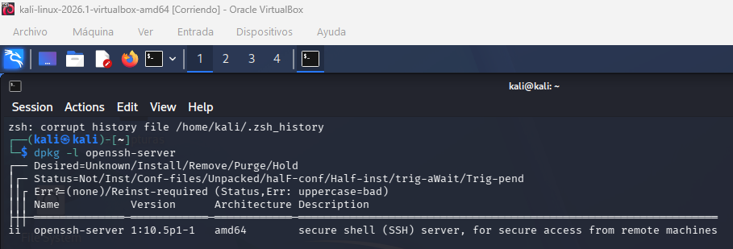
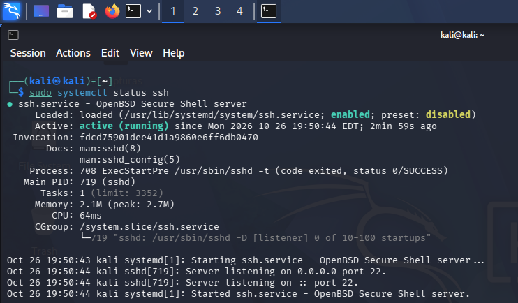
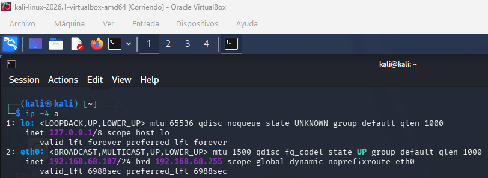
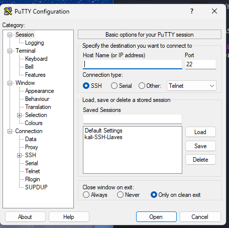
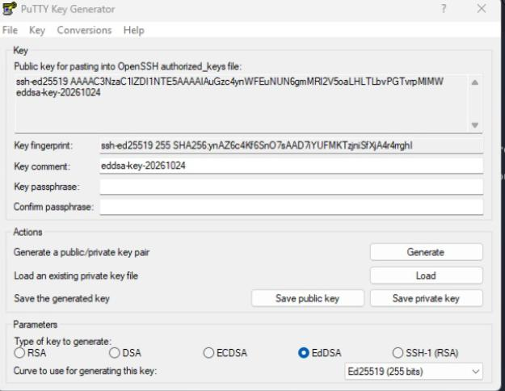
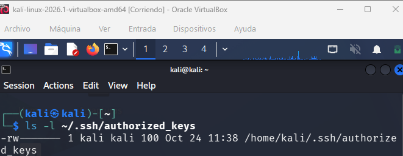
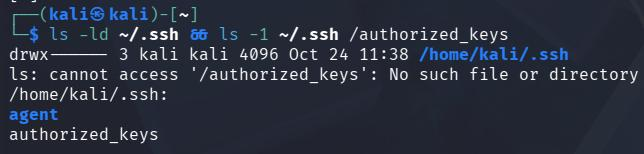

# Laboratorio SSH | Kali Linux, PuTTY y autenticación mediante llaves

## Descripción del proyecto

Laboratorio académico colaborativo desarrollado durante el Módulo 3 del Técnico en Ciberseguridad de la Universidad Latina de Costa Rica.

El objetivo fue configurar un servicio de acceso remoto seguro mediante SSH en Kali Linux y establecer una conexión desde un equipo Windows utilizando PuTTY y autenticación mediante llaves criptográficas.

## Objetivos

- Instalar y configurar OpenSSH Server en Kali Linux.
- Comprobar el estado del servicio SSH.
- Identificar la dirección IP del servidor.
- Generar un par de llaves criptográficas mediante PuTTYgen.
- Configurar la llave pública en el servidor Linux.
- Establecer los permisos adecuados del archivo authorized_keys.
- Realizar una conexión SSH desde Windows utilizando PuTTY.

## Tecnologías utilizadas

- Kali Linux
- Windows
- OpenSSH Server
- PuTTY
- PuTTYgen
- Criptografía de clave pública ED25519
- Oracle VirtualBox

## Desarrollo del laboratorio

### 1. Instalación y verificación de SSH

Se instaló OpenSSH Server en Kali Linux y se verificó que el servicio SSH estuviera activo y en ejecución.

### 2. Identificación de la dirección IP

Se utilizó el comando ip a para identificar la dirección IPv4 del equipo Kali Linux y preparar la conexión desde Windows.

### 3. Generación de llaves criptográficas

Mediante PuTTYgen se generó un par de llaves ED25519.

La llave pública se utilizó para autorizar el acceso al servidor Linux y la llave privada se conservó en el equipo cliente.

También se configuró una passphrase para proteger el uso de la llave privada.

### 4. Configuración de authorized_keys

Se incorporó la llave pública al archivo ~/.ssh/authorized_keys del usuario Linux.

Se establecieron permisos restrictivos para proteger el archivo de claves autorizadas.

Comando utilizado:

```bash
chmod 600 ~/.ssh/authorized_keys
```

### 5. Conexión mediante PuTTY

Se configuró una sesión en PuTTY utilizando la dirección IP del servidor Kali Linux, el puerto SSH y la llave privada correspondiente en formato .ppk.

Se realizó una prueba de autenticación y se obtuvo acceso a una terminal remota de Kali Linux.

## Dificultades encontradas

- Problemas iniciales de conectividad entre Windows y Kali Linux.
- Necesidad de verificar la dirección IP correcta del servidor.
- Ajustes en la generación y configuración de las llaves.
- Verificación de los permisos del archivo authorized_keys.
- Intentos iniciales de autenticación antes de conseguir una conexión exitosa.

## Aprendizajes

- Funcionamiento básico del protocolo SSH.
- Diferencia entre llave pública y llave privada.
- Función de una passphrase en la protección de la llave privada.
- Importancia de los permisos de archivos en Linux.
- Uso de PuTTY para administrar conexiones remotas.
- Diagnóstico de problemas de conectividad y autenticación.

## Evidencias del laboratorio

### 1. Instalación del servicio SSH


### 2. Verificación del servicio SSH activo


### 3. Dirección IP de Kali Linux


### 4. Prueba de conectividad


### 5. Configuración de PuTTY


### 6. Generación de llaves con PuTTYgen


### 7. Configuración de authorized_keys


### 8. Configuración de permisos SSH


### 9. Sesión SSH establecida


**Nota:** La captura de la sesión establecida demuestra acceso remoto mediante SSH, pero no permite confirmar por sí sola que la autenticación final utilizara una llave privada.

No se publicarán llaves privadas, contraseñas ni passphrases.

## Alcance y autoría

Proyecto académico realizado en colaboración como parte de las prácticas del Módulo 3.

El contenido documenta un entorno de aprendizaje autorizado y no representa experiencia profesional administrando servidores de producción.
